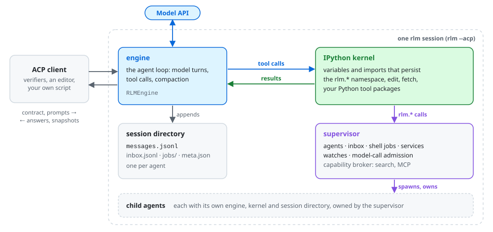

# nano-rlm

A minimal recursive language-model agent. The model works through one persistent IPython kernel: Python, shell commands, file edits and orchestration all happen there, and the kernel's state survives across turns and context compaction. From that kernel the agent can spawn sub-agents, each with its own kernel, and coordinate them like any other Python object.

nano-rlm runs as an [Agent Client Protocol](https://agentclientprotocol.com/) agent and is built as a training harness: every session is configured by one explicit runtime contract, and every model call, message and tool result is recorded. For a full-fledged coding agent built on the same principles, see [prime-agent](https://github.com/PrimeIntellect-ai/prime-agent).

<picture>
  <source media="(prefers-color-scheme: dark)" srcset="docs/images/overview-dark.svg">
  
</picture>

- **One persistent kernel.** By default the model has a single tool, `ipython`. Shell work goes through `rlm.shell.run` or `!cmd`, edits through the pre-imported `edit`, and variables, imports and loaded data persist from cell to cell.
- **Recursion from Python.** `await rlm.agent.spawn(task=...)` returns a handle to a sub-agent that keeps running across cells. Agents report to their parent's inbox, and the parent waits, steers, reads their history or cancels them.
- **Supervised background work.** Shell jobs, long-lived services and watches on agents, jobs and paths are owned by a supervisor, so they survive a lost variable or a kernel crash.
- **Unbounded sessions.** The engine compacts the context into a handoff summary when it runs out of room; the kernel keeps its state and the full history stays readable from Python.
- **Tools where they belong.** Native tool calls (`bash`, `edit`, `fetch`), Python tool packages, `SKILL.md` workflows, and MCP servers whose credentials never reach the kernel.
- **Split execution.** The agent loop and credentials can stay in the harness while the tools run in a separate workspace, over stdio or TCP.

## Install

```bash
git clone https://github.com/PrimeIntellect-ai/nano-rlm.git
cd nano-rlm
uv sync
```

## Quickstart

`rlm --acp` serves one ACP agent over stdio. A client starts it, sends the runtime contract with `session/new`, and prompts it. This client works against any OpenAI-compatible endpoint:

```python
import asyncio
import os

from acp import PROTOCOL_VERSION, spawn_agent_process, text_block


class Client:
    async def session_update(self, session_id, update, **kwargs):
        if getattr(update, "session_update", None) == "agent_message_chunk":
            print(update.content.text)


async def main():
    runtime = {
        "session_id": "quickstart",
        "model": "your-model",
        "provider": {
            "base_url": "https://your-endpoint/v1",
            "api_key": os.environ["API_KEY"],
            "headers": {},
        },
        "policy": {},
        "system_prompt_path": None,
        "append_to_system_prompt": None,
        "skills": ["edit"],
        "kernel_env": {},
        "search_api_key": None,
    }
    async with spawn_agent_process(Client(), "rlm", "--acp") as (agent, _process):
        await agent.initialize(PROTOCOL_VERSION)
        session = await agent.new_session(
            cwd=os.getcwd(), mcp_servers=[], **{"ai.prime.rlm/runtime-v1": runtime}
        )
        await agent.prompt(
            session_id=session.session_id,
            prompt=[text_block("How many Python files are in this directory?")],
        )
        await agent.close_session(session.session_id)


asyncio.run(main())
```

Run it with `uv run python quickstart.py`. The session's ledger lands in `~/.rlm/sessions/` (`$RLM_HOME` moves it). [The runtime contract](docs/runtime-contract.md) lists every field and policy.

## Documentation

| Page | What it covers |
|---|---|
| [Architecture](docs/architecture.md) | The engine, kernel, supervisor and session directory, and one turn through them |
| [Runtime contract](docs/runtime-contract.md) | The ACP surface: the runtime object, policy, prompts, steering, snapshots and tracing headers |
| [Python API](docs/python-api.md) | The `rlm` namespace in the kernel: agents, inbox, shell jobs, services, watches, history, hints |
| [Tools and skills](docs/tools.md) | Native tools, built-in Python tools, tool packages, `SKILL.md` skills, MCP servers, the kernel's environment |
| [Context and history](docs/context.md) | Compaction, tool-output truncation, the `messages.jsonl` ledger and reading it back |
| [Kernel and processes](docs/processes.md) | Timeouts, crash recovery, and which processes outlive a call, a restart or the session |
| [Split execution](docs/split-execution.md) | Running the tools in a separate workspace, over stdio or TCP |

## Developing

```bash
uv sync --group dev
uv run pre-commit install
uv run ruff check --fix . && uv run ruff format .
uv run pytest tests/
```

The end-to-end suite in `tests/e2e` gives a hosted model real tasks through `rlm --acp`
and checks what the agent leaves in its workspace, with tools in the agent's process
tree, in a [split-execution](docs/split-execution.md) worker over stdio, and in one
over TCP. It runs only when asked for and needs a Prime Inference key (`PRIME_TEAM_ID`
too for a team's models):

```bash
PRIME_API_KEY=... uv run pytest tests/e2e -m e2e
```

`RLM_E2E_MODEL` picks the model (default `internal/glm-5.3-fast`) and `RLM_E2E_BASE_URL`
the endpoint.
