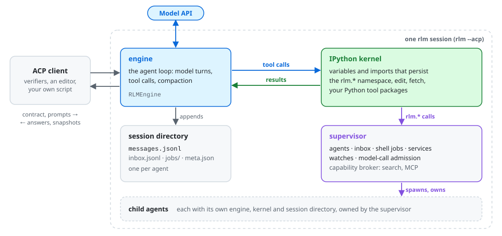

# Architecture

nano-rlm gives a model one place to work, a persistent IPython kernel, and lets it extend itself with sub-agents and background work from there. Everything that has to outlive a single cell, such as agents, jobs, services, inbox events and the conversation itself, belongs to processes the kernel cannot lose: the engine and the supervisor.

<picture>
  <source media="(prefers-color-scheme: dark)" srcset="images/overview-dark.svg">
  
</picture>

## Components

**ACP agent.** `rlm --acp` serves the [Agent Client Protocol](https://agentclientprotocol.com/) over stdio. Each ACP session owns one engine for its lifetime. The session is configured entirely by the [runtime contract](runtime-contract.md) the client sends; nothing is read from the process environment except `RLM_HOME`.

**Engine** (`RLMEngine`). The agent loop: it sends the conversation to the model, runs the tool calls the model makes, appends every message to the ledger, and compacts the context when it runs out of room. Model credentials live here and in the supervisor, never in the kernel.

**IPython kernel.** One persistent Jupyter kernel per agent, running in rlm's own Python. Variables, imports and loaded data persist across cells, across turns and across compaction. The `rlm` package is importable in it, and enabled built-in Python tools (`edit`, `fetch`, ...) and installed tool packages are pre-imported by name. The kernel starts from a minimal environment, so ambient credentials do not reach it ([details](tools.md#the-kernels-environment)).

**Supervisor.** Owns everything that must outlive a cell: child agents and their inboxes, shell jobs, services, watches, muted hints, and the admission of model calls across the agent tree. The kernel reaches it through `rlm.*` calls on a session-local capability broker. The broker also runs credentialed tools, such as `search` and MCP servers, on the kernel's behalf, so their keys and URLs stay out of the kernel.

**Child agents.** `rlm.agent.spawn(...)` asks the supervisor for a child: another engine with its own kernel and session directory, configured from the parent's contract one level deeper. Children can spawn their own children up to `max_depth`. The parent holds a handle; losing the handle does not stop the child.

**Population episodes.** A session with a population policy runs as one episode of depth-0 peer agents instead of one root tree: founders plus `independent=True` spawns, all with the same authority, plus each peer's own beholden children. Peer input lands in the recipient's inbox behind one coalesced notice, and the supervisor owns admission caps, retirement (passivation with full teardown), the shared board, the compare-and-swap episode answer and the episode's stop ([details](runtime-contract.md#population-episodes)).

**Session directory.** Each agent writes `$RLM_HOME/sessions/<id>/`, with children nested under it as `sub-<id>/`. Its `messages.jsonl` is the append-only ledger of the conversation, which the agent itself can read back from Python ([Context and history](context.md)).

## One turn

1. The client sends `session/prompt`. The engine appends the prompt to the ledger and asks the supervisor for a model-call slot (`max_concurrent_subagents` bounds calls across the whole tree).
2. The model answers with text or tool calls. For an `ipython` call the engine runs the cell in the kernel; native `bash`, `edit` and `fetch` calls run beside it.
3. While the cell runs, its `rlm.*` calls (spawn an agent, read the inbox, start a job) go to the supervisor and return into the cell.
4. The tool result enters the conversation, truncated to its first and last 10 KB when longer ([details](context.md#tool-output)). The engine loops until the model answers without tool calls, a budget runs out, or the client cancels.
5. The answer goes back to the client as an agent message, and the ACP response carries a credential-free snapshot of usage, metrics and limits.

Between turns, the kernel and every supervisor-owned resource stay alive; the next prompt continues the same conversation.

## Trust boundaries

- **Credentials.** The model's provider key travels over the private ACP stdio channel and stays in the engine. Search and MCP credentials stay in the supervisor. The kernel's environment is rebuilt from an allowlist plus the contract's `kernel_env`.
- **Not containment.** In local execution the kernel shares the user, filesystem, process namespace and network with the engine. Filesystem access between agents is trusted; agent handles are orchestration controls, not isolation.
- **Real separation** comes from [split execution](split-execution.md): the tools run in a separate workspace, such as a container or VM, and only tool calls cross between them.
