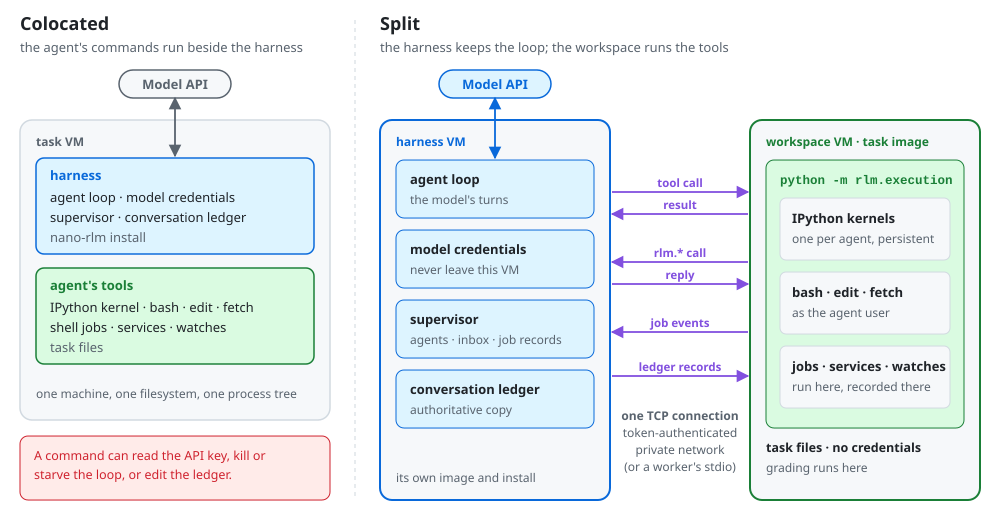
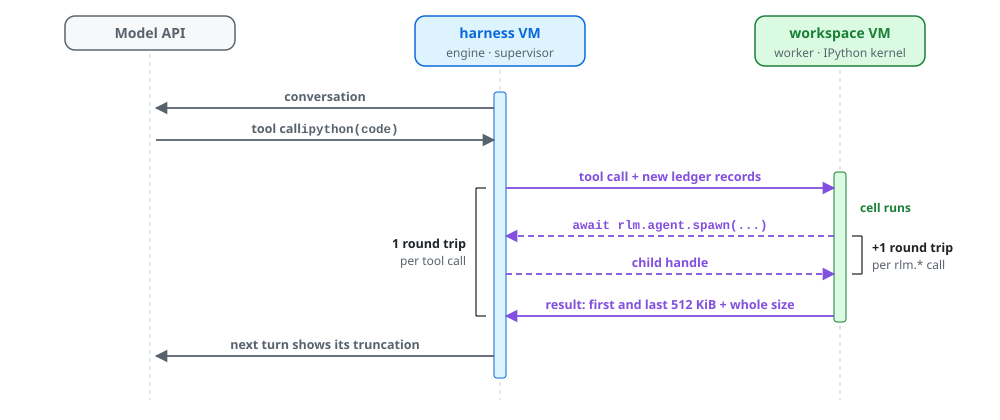

# Split execution

By default the agent's tools run beside the harness: the agent loop, the model credentials, the supervisor and the ledger share a filesystem and a process tree with every command the agent runs. A command can then read the credentials, kill or starve the loop, or rewrite the ledger, and the harness's own install is part of the environment being graded.

Split execution moves the boundary to the tool call. The harness keeps the loop, the credentials, the supervisor and the authoritative conversation, and a worker in a separate workspace, such as a container or VM, runs the tools. The model sees the same tools, prompt and results.

<picture>
  <source media="(prefers-color-scheme: dark)" srcset="images/split-execution-dark.svg">
  
</picture>

## How it works

- **Tool calls cross the boundary.** `ipython`, `bash`, `edit` and `fetch` travel as a name and arguments to `python -m rlm.execution` in the workspace, which hosts the persistent kernels, the built-in Python tools, interruption and kernel recovery. File operations happen in the workspace. Recursive agents use the same worker, each with a kernel of its own, and share the workspace.
- **`rlm.*` calls come back.** A cell's calls into the supervisor return over the same connection, scoped to the agent that made them. The supervisor's shell jobs, services and path watches run in the workspace, beside the kernels, while the supervisor keeps their records and inbox events. The agent gets the same runtime prompt and API as in local execution.
- **The ledger follows the cell.** Before each cell the worker receives the conversation's new records, in chunks that fit a frame, so `history()` reads locally in the workspace. A child's history comes from the supervisor in pages.
- **Bounded frames.** Messages are length-prefixed JSON of at most 16 MiB. A command or cell keeps the first and last 512 KiB of its output, so any result fits.

<picture>
  <source media="(prefers-color-scheme: dark)" srcset="images/split-execution-step-dark.svg">
  
</picture>

## Configuring it

Both sides need the same nano-rlm version. The runtime contract takes one of two transports:

**stdio.** `execution_command` is a trusted argv that starts the worker, and `execution_cwd` is the tools' working directory in the workspace:

```json
{
  "execution_command": ["docker", "exec", "-i", "task-container", "/opt/rlm/bin/python", "-m", "rlm.execution"],
  "execution_cwd": "/workspace"
}
```

Calls and callbacks share the worker's stdio, so the workspace can have networking disabled. The command defines the isolation boundary: a worker started as a local process gives process separation, not filesystem isolation.

**TCP.** For a trusted private network, start the worker with a random token of at least 32 characters:

```bash
RLM_EXECUTION_TOKEN=... python -m rlm.execution --listen 0.0.0.0 --port 0
```

With `--port 0` the kernel picks a free port, and the worker prints `listening on HOST:PORT` on stderr once it accepts connections. Then set `execution_tcp` instead of `execution_command`:

```json
{
  "execution_tcp": {"host": "10.0.0.5", "port": 41234, "token": "..."},
  "execution_cwd": "/workspace"
}
```

Each connection is a separate execution session. The token authenticates connections, and the worker removes it from its environment before starting tools. The transport does not encrypt, so use a private network or an encrypted tunnel.

`initialize` advertises `ai.prime.rlm/execution-v1` with the supported transports (`stdio`, `tcp`) and tools (`ipython`, `bash`, `edit`, `fetch`). In code, `ExecutionTransport` supplies `connect()` (a reader and writer) and `close()`, independently of tool dispatch.

## What it costs

A tool call adds one round trip between harness and worker, each `rlm.*` call one more, and `rlm.shell.run` two. The worker holds a running job's new output for up to 50 ms, so a short command's output and exit arrive together, and both ends set `TCP_NODELAY`. On a cloud provider's private network a round trip is typically tens to a few hundred milliseconds.

## Responsibilities

The orchestrator provisions the workspace, starts the worker or listener, and tears both down. A worker that disconnects fails the session. Process lifetimes are those of [local execution](processes.md#which-processes-outlive-what): a closing session stops what is attached to its kernels, while daemons, services and `bash` background jobs keep running, so stopping what remains when a rollout ends is the orchestrator's job. Kernel recovery works as locally, including never replaying an interrupted cell.

The prompt lists Python tool packages and `SKILL.md` skills from the harness's installation, but the agent imports and reads them in the workspace, so the workspace needs the same packages and files. Built-in Python tools work as in local execution, and MCP calls still run in the harness's supervisor.
